# Strategic Game Playing Agent Using Deep Q-Learning (DQN)

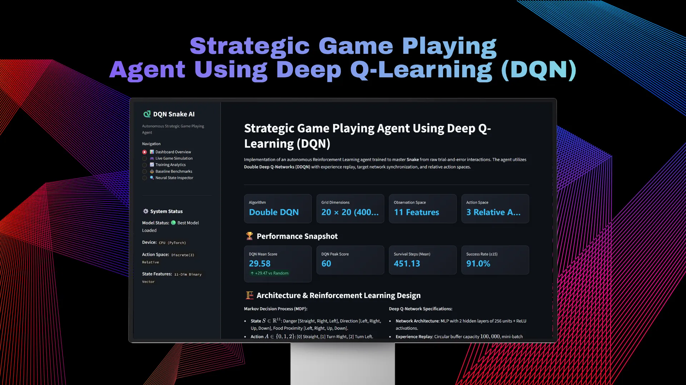


## Project Overview

Strategic Game Playing Agent Using Deep Q-Learning (DQN) is an end-to-end Reinforcement Learning project that trains an autonomous agent to play Snake on a custom `20 x 20` Markov Decision Process (MDP) grid environment without hardcoded pathfinding heuristics. Built with Python and PyTorch, the agent uses a Double Deep Q-Network (DDQN) over an 11-dimensional egocentric state vector and a 3-action relative steering space, supported by experience replay, periodic target network synchronization, comparative baseline benchmarking, automated unit/integration tests, and an interactive dark-theme Streamlit analytics dashboard.

## Problem Statement & Objectives

Playing Snake effectively is a constrained sequential decision-making and dynamic pathfinding problem where every food item consumed elongates the snake's body, continuously altering obstacle geometry across the `20 x 20` arena. Naive greedy movement toward food frequently traps the agent inside dead-end pockets formed by walls and its own trailing segments, while terminal collisions yield immediate episode failure.

- Formulate Snake gameplay as a deterministic, seed-reproducible MDP (`SnakeGame`) with an 11-feature binary observation vector, relative steering actions (`STRAIGHT`, `TURN_RIGHT`, `TURN_LEFT`), starvation timeout protection, and asymmetric distance-shaped rewards.
- Train a Multi-Layer Perceptron Q-network using Double DQN target estimation, an experience replay buffer of `100,000` transitions, Huber loss (`SmoothL1Loss`), gradient norm clipping, and exponential epsilon-greedy decay.
- Benchmark the trained policy across `100` multi-seed evaluation episodes (`[42, 101, 202, 303, 404]`) against both a `RandomAgent` and a lookahead `HeuristicAgent`.
- Provide visual diagnostics, persisted PyTorch checkpoints, and an interactive Streamlit dashboard (`streamlit/app.py`) featuring live gameplay simulation and a neural state Q-value inspector.

## Data & Input Sources

This Reinforcement Learning project does not rely on a static pre-collected training dataset; instead, experience transitions `(state, action, reward, next_state, done)` are generated dynamically through online interaction between the `DQNAgent` and the `SnakeGame` environment (`src/environment/game.py`) and stored in an in-memory `ReplayBuffer`. Training progression and comparative evaluation records are persisted locally as CSV and JSON telemetry files for analysis and dashboard rendering.

| Attribute | Description |
| :--- | :--- |
| **Dataset / Input Source** | Online MDP environment transitions (`SnakeGame` `20 x 20` grid) and persisted experiment logs |
| **Source** | Generated via `src/environment/game.py`, logged to `metrics/training_metrics.csv`, `evaluation/evaluation_results.csv`, and `evaluation/evaluation_summary.json` |
| **Format** | `np.float32` state tensors (`(11,)`), CSV telemetry tables, and JSON benchmark summaries |
| **Samples / Records** | `500` logged training episodes (`36,696` total environment steps in `training_metrics.csv`) and `300` evaluation episode rows (`100` per agent) |
| **Features / Input Shape** | `(11,)` binary vector: 3 relative danger flags, 4 absolute heading flags, 4 relative food direction flags |
| **Target / Label** | Scalar shaped step reward (`+10.0` food, `-10.0` collision/starvation, `+0.1` closer, `-0.15` farther, `-0.01` step penalty) and bootstrapped Double DQN target Q-values |

## Tech Stack

| Category | Technology | Purpose |
| :--- | :--- | :--- |
| **Language** | Python | Core implementation across environment, agent, training, evaluation, and UI modules |
| **Deep Learning** | PyTorch | Q-Network (`QNetwork`, `DuelingQNetwork`), Double DQN Bellman updates, Huber loss, Adam optimizer, `.pt` checkpointing |
| **Numerical Computing** | NumPy | Observation vector construction, seeded RNG, and episode statistical aggregation |
| **Data Processing** | Pandas | Logging training metrics (`TrainingLogger`) and structuring multi-seed evaluation CSV/JSON tables |
| **Visualization** | Matplotlib | Publication-style dark-theme learning curves, boxplots, histograms, and summary scorecard PNGs |
| **Rendering** | Pillow | Headless `SnakeRenderer` board frame generation and animated gameplay GIF export |
| **Configuration** | PyYAML | Centralized hyperparameter and environment configuration parsing from `config/config.yaml` |
| **Web Dashboard** | Streamlit | Interactive 5-page dark-theme dashboard (`streamlit/app.py`) for simulation and Q-value inspection |
| **Testing & Reporting** | Pytest, Tabulate | Automated 15-case unit/integration test suite (`tests/`) and formatted evaluation console tables |

## Machine Learning Approach

The project applies model-free value-based **Reinforcement Learning** using **Double Deep Q-Learning (DDQN)** to approximate the optimal action-value function $Q^*(s, a)$ directly from environment rewards without an explicit transition model. An egocentric relative action space eliminates illegal 180-degree self-reversals, while asymmetric Manhattan-distance reward shaping (`+0.10` closer vs. `-0.15` farther, plus `-0.01` step cost) prevents reward-looping oscillations.

| Attribute | Value |
| :--- | :--- |
| **Learning Paradigm** | Reinforcement Learning |
| **Problem Domain** | Sequential Game Playing & Dynamic Grid Navigation (`SnakeGame`) |
| **ML Task** | Value-Based Policy Optimization / Sequential Decision-Making |
| **Input** | 11-dimensional binary `float32` state vector (`[danger_straight, danger_right, danger_left, dir_left, dir_right, dir_up, dir_down, food_left, food_right, food_up, food_down]`) |
| **Target / Output** | 3-dimensional Q-value vector for relative actions `0` (`STRAIGHT`), `1` (`TURN_RIGHT`), `2` (`TURN_LEFT`) |
| **Approach** | Double DQN action selection via `policy_net` and target evaluation via periodically synced `target_net`, trained with experience replay |

## Model Overview

The primary trained model is `QNetwork` (`src/agent/model.py`), a 3-layer Multi-Layer Perceptron (`11 -> 256 -> 256 -> 3`) initialized with Kaiming Uniform weights and ReLU hidden activations, paired with an identical frozen `target_net` synchronized every `500` optimization steps. The codebase also implements `DuelingQNetwork` (value and advantage stream decomposition) as an optional architecture in `src/agent/model.py`, alongside non-learned `RandomAgent` and `HeuristicAgent` baselines in `src/evaluation/baselines.py` for comparative evaluation.

| Attribute | Description |
| :--- | :--- |
| **Primary Model** | `QNetwork` (3-layer MLP: `11 -> 256 -> 256 -> 3`, ReLU activations, linear Q-value output) |
| **Alternative Architecture** | `DuelingQNetwork` implemented in `src/agent/model.py` (`use_dueling=False` during the main trained run) |
| **Target Estimation** | Double DQN (`use_double_dqn=True`) using `policy_net` for `argmax` action selection and `target_net` for value estimation |
| **Replay Memory** | Cyclic `ReplayBuffer` with capacity `100,000` transitions and uniform mini-batch sampling (`batch_size=64`) |
| **Pretrained Status** | Trained from scratch in this repository (`models/best_model.pt` and periodic checkpoints in `models/checkpoints/`) |
| **Baselines** | `RandomAgent` (uniform random `[0, 1, 2]`) and `HeuristicAgent` (collision-filtered Manhattan distance greedy lookahead) |

## ML Workflow

1. **Configure Environment & Hyperparameters**: Load grid dimensions, reward coefficients, network dimensions, replay capacity, and evaluation seeds from [`config/config.yaml`](config/config.yaml).
2. **Simulate MDP Gameplay**: Initialize [`src/environment/game.py`](src/environment/game.py) (`SnakeGame`) to generate 11-dimensional state observations, apply relative actions, compute distance-shaped rewards, and enforce wall, self-collision, and starvation limits.
3. **Train Double DQN Policy**: Run [`src/training/train.py`](src/training/train.py) (`DQNAgent` in [`src/agent/dqn_agent.py`](src/agent/dqn_agent.py)) to collect transitions in [`src/agent/replay_buffer.py`](src/agent/replay_buffer.py), sample 64-transition mini-batches, optimize `QNetwork` with Huber loss (`SmoothL1Loss`) and Adam (`lr=0.0005`), decay epsilon, and log per-episode metrics via [`src/training/callbacks.py`](src/training/callbacks.py) to [`metrics/training_metrics.csv`](metrics/training_metrics.csv).
4. **Select & Checkpoint Models**: Persist periodic checkpoints every 100 episodes (`models/checkpoints/checkpoint_ep100.pt` through `checkpoint_ep500.pt`) and save [`models/best_model.pt`](models/best_model.pt) whenever the 30-episode rolling score improves after episode 20.
5. **Run Multi-Seed Comparative Evaluation**: Execute [`src/evaluation/evaluate.py`](src/evaluation/evaluate.py) over 100 episodes across 5 seeds (`[42, 101, 202, 303, 404]`) with $\epsilon = 0.0$ against baselines from [`src/evaluation/baselines.py`](src/evaluation/baselines.py), exporting [`evaluation/evaluation_results.csv`](evaluation/evaluation_results.csv) and [`evaluation/evaluation_summary.json`](evaluation/evaluation_summary.json).
6. **Generate Visual Artifacts & Interactive Inspection**: Render training curves, baseline comparisons, and gameplay animations using [`src/visualization/plots.py`](src/visualization/plots.py) and [`src/environment/renderer.py`](src/environment/renderer.py), and explore policies interactively via [`streamlit/app.py`](streamlit/app.py) (documented in [`final_report.md`](final_report.md)).

## ML Pipeline Architecture

The pipeline links the `SnakeGame` MDP simulator with the `DQNAgent` training loop, replay memory, checkpoint persistence, multi-seed baseline evaluation, and downstream Matplotlib and Streamlit reporting layers.

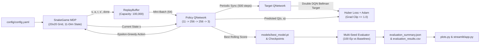

## Model Training & Configuration

Training was executed from scratch on CPU for **500 episodes** with random seed `42` (`metrics/training_metrics.csv`, total logged episode compute time `70.40s`, `70.68s` wall-clock reported in `final_report.md`), reaching a peak training episode score of **27 apples** at Episode `457` (`total_reward = 292.65`, `461` steps) and a peak 30-episode rolling average score of **9.20 apples** at Episode `477`. Note that `config/config.yaml` lists `episodes: 600` as the default YAML template, whereas the committed `metrics/training_metrics.csv` and `checkpoint_ep100.pt`..`checkpoint_ep500.pt` artifacts correspond to the executed 500-episode run.

| Parameter | Verified Value | Role in Training |
| :--- | :--- | :--- |
| **Grid Dimensions** | `20 x 20` (`400` cells) | Playable arena size (`max_idle_steps_multiplier = 100`) |
| **State / Action Dim** | `11` / `3` | Egocentric binary features and relative steering actions |
| **Hidden Layers** | `[256, 256]` (ReLU) | Two-hidden-layer MLP capacity (`QNetwork`) |
| **Optimizer & LR** | `Adam`, `lr = 0.0005` | Policy network gradient updates |
| **Loss Function** | `SmoothL1Loss` (Huber) | Dampens large TD-error spikes during long episodes |
| **Discount Factor ($\gamma$)** | `0.99` | Weights long-horizon survival and apple collection |
| **Batch Size / Buffer** | `64` / `100,000` | Decorrelated mini-batch experience replay |
| **Target Sync Freq** | `500` optimization steps | Periodic hard copy from `policy_net` to `target_net` |
| **Gradient Clipping** | `1.0` (L2 norm) | Prevents gradient explosion on terminal collisions |
| **Epsilon Schedule** | `1.0 -> 0.01` (`decay = 0.995`) | Reached `epsilon = 0.0816` at Episode `500` |
| **Executed Episodes / Seed** | `500` episodes / `seed = 42` | Generated `36,696` steps and `models/best_model.pt` |

```bash
python -m src.training.train --episodes 500 --seed 42
```

## Model Comparison & Selection

To validate learned strategic behavior beyond random movement or myopic rule-based navigation, the best checkpoint (`models/best_model.pt`) was evaluated greedily ($\epsilon = 0.0$) over **100 episodes** across 5 seeds (`[42, 101, 202, 303, 404]`) against `RandomAgent` and `HeuristicAgent` (`evaluation/evaluation_summary.json`).

| Agent | Episodes | Mean Score | Median Score | Std Dev | Min / Max Score | Mean Reward | Mean Steps | Success Rate ($\ge 15$) | Total Eval Time |
| :--- | :---: | :---: | :---: | :---: | :---: | :---: | :---: | :---: | :---: |
| **DQN Agent** | 100 | **29.58** | **30.0** | 10.84 | **6 / 60** | **+320.25** | **451.13** | 91.0% | 6.12s |
| **Heuristic (Rule-based)** | 100 | 28.22 | 26.5 | 11.12 | 5 / 57 | +305.05 | 432.20 | **92.0%** | 1.35s |
| **Random Agent** | 100 | 0.11 | 0.0 | 0.31 | 0 / 1 | -11.42 | 61.28 | 0.0% | 0.09s |

## Model Artifacts & Checkpoints

All model checkpoints and telemetry outputs generated by the training and evaluation runs are stored directly in the repository.

| Artifact | Format | Purpose | Repository Path |
| :--- | :---: | :--- | :--- |
| **Best Policy Checkpoint** | `.pt` | Policy, target, and optimizer state dicts selected by best 30-episode rolling score | [`models/best_model.pt`](models/best_model.pt) |
| **Periodic Checkpoints** | `.pt` | Epoch-100 interval snapshots (`ep100`, `ep200`, `ep300`, `ep400`, `ep500`) | [`models/checkpoints/`](models/checkpoints) |
| **Training Metrics Log** | `.csv` | Per-episode score, rolling score, reward, steps, epsilon, Huber loss, and duration | [`metrics/training_metrics.csv`](metrics/training_metrics.csv) |
| **Evaluation Episode Log** | `.csv` | 300 episode-level records across all three evaluated agents and 5 seeds | [`evaluation/evaluation_results.csv`](evaluation/evaluation_results.csv) |
| **Evaluation Summary** | `.json` | Aggregated benchmark metrics for DQN, Random, and Heuristic agents | [`evaluation/evaluation_summary.json`](evaluation/evaluation_summary.json) |

## Model Evaluation & Results

On the independent 100-episode multi-seed evaluation suite (`evaluation/evaluation_summary.json`, $\epsilon = 0.0$), the trained `DQN Agent` achieved an average score of **29.58 apples**, outperforming `Random Agent` (`0.11` apples) and surpassing the collision-aware `Heuristic (Rule-based)` baseline (`28.22` apples) in mean score, median score (`30.0` vs. `26.5`), peak score (`60` vs. `57`), mean cumulative reward (`+320.25` vs. `+305.05`), and mean survival length (`451.13` vs. `432.20` steps). Note that training metrics (peak `27` apples under $\epsilon$-greedy exploration) and evaluation metrics (mean `29.58`, peak `60` apples under deterministic $\epsilon = 0.0$ across unseen seeds) are strictly separated.

| Evaluation Metric | DQN Agent (Eval $\epsilon=0$) | Random Baseline | Heuristic Baseline |
| :--- | :---: | :---: | :---: |
| **Mean Game Score** | **29.58** | 0.11 | 28.22 |
| **Median Game Score** | **30.0** | 0.0 | 26.5 |
| **Peak Game Score** | **60** | 1 | 57 |
| **Mean Cumulative Reward** | **+320.25** | -11.42 | +305.05 |
| **Mean Survival Steps** | **451.13** | 61.28 | 432.20 |
| **Success Rate (Score $\ge 15$)** | 91.0% | 0.0% | **92.0%** |

- **Strategic Long-Horizon Routing**: Unlike the myopic Manhattan-distance heuristic (`28.22` mean score), the Double DQN policy trained with $\gamma = 0.99$ avoids premature self-enclosure along walls and sustains higher median and maximum scores (`30.0` median, `60` max).
- **Local Perception Limitation**: Because the 11-dimensional state vector only inspects 1-cell immediate danger around the head, the agent lacks global flood-fill visibility when body length exceeds ~40 cells, occasionally entering closed U-shaped tail pockets (responsible for the `9%` of episodes scoring below `15`, with a minimum score of `6`).
- **Automated Test Verification**: The 15-case `pytest` suite (`tests/test_environment.py`, `tests/test_agent.py`, `tests/test_training.py`) covers MDP step/reset validity, collision and starvation handling, `QNetwork`/`DuelingQNetwork` tensor shapes, `ReplayBuffer`, checkpoint round-trips, and training/evaluation smoke runs.

## Results Visualization & Preview

### 1. Dashboard Overview & Performance Snapshot
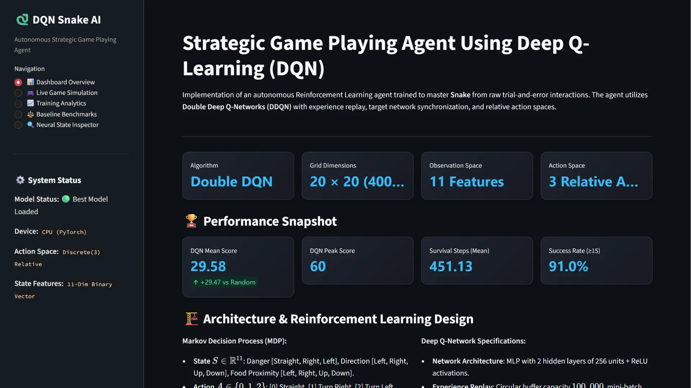
The main overview page of the dark-theme `DQN Snake AI` Streamlit interface presents the Double DQN architecture specifications (`20 x 20` grid, 11 observation features, 3 relative actions) alongside headline evaluation metrics (`29.58` mean score, `60` peak score, `451.13` mean survival steps, and `91.0%` success rate).

### 2. Live Gameplay Demonstration Simulator
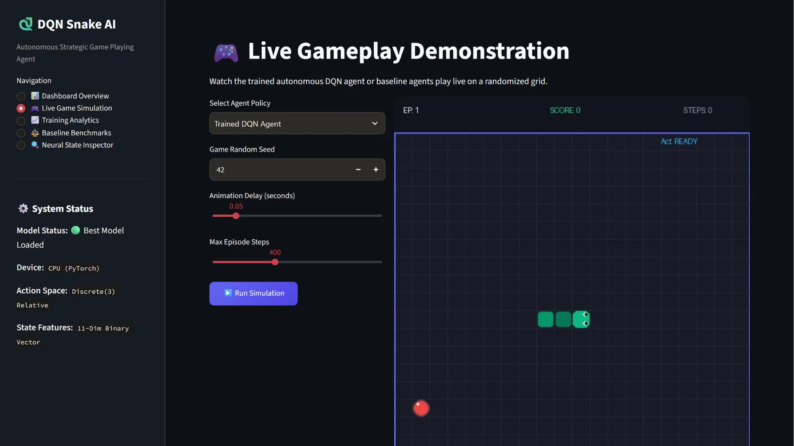
The interactive simulation view enables real-time episode playback for the trained DQN, Heuristic, or Random agents with configurable random seeds, animation frame delay, and maximum step limits rendered directly on the `20 x 20` grid.

### 3. Training Dynamics & Loss Progression Dashboard
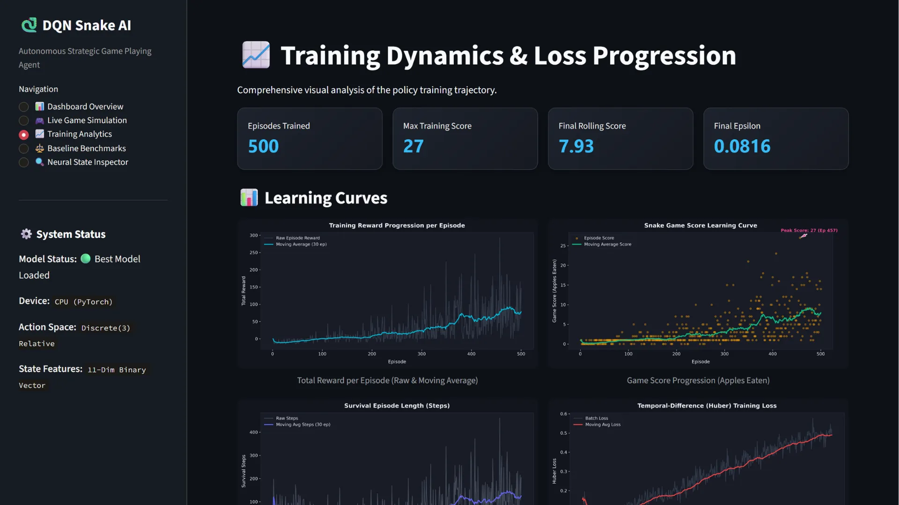
The Training Analytics view aggregates summary statistics from the 500-episode training run (`Max Training Score: 27`, `Final Rolling Score: 7.93`, `Final Epsilon: 0.0816`) above synchronized reward, score, survival-length, and Huber loss progression plots.

### 4. Baseline Evaluation & Comparative Benchmarks Dashboard
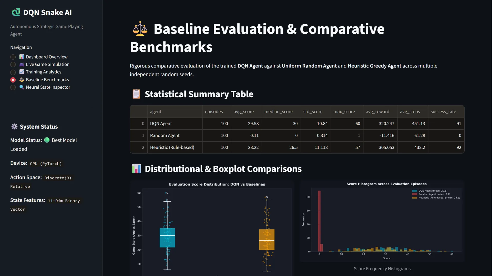
The comparative benchmark view contrasts 100-episode multi-seed statistics across `DQN Agent`, `Random Agent`, and `Heuristic (Rule-based)` policies alongside distributional boxplots and score frequency histograms.

### 5. Neural State & Q-Value Inspector
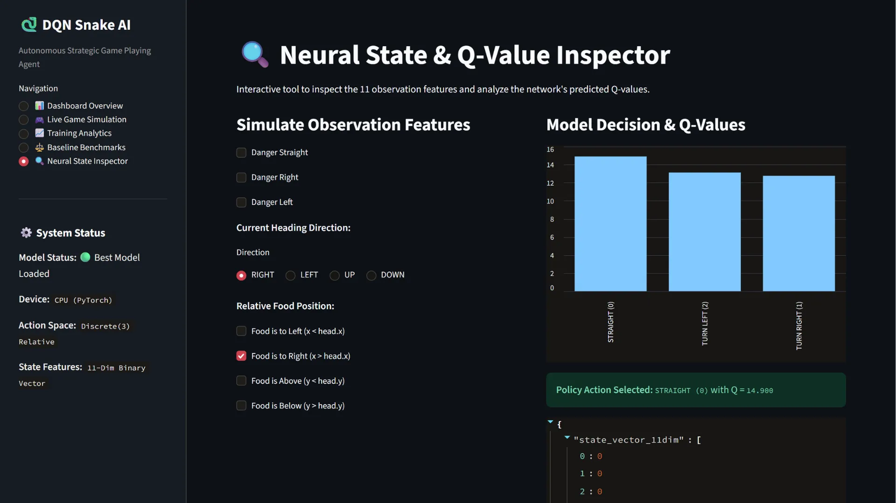
The Neural State Inspector allows interactive toggling of the 11 binary state features (local dangers, current heading, and relative food direction) to inspect predicted Q-values—such as selecting `STRAIGHT (0)` with `Q = 14.900` when food lies directly ahead with zero danger.

### 6. Gameplay Snapshot & Evaluation Distribution Summary
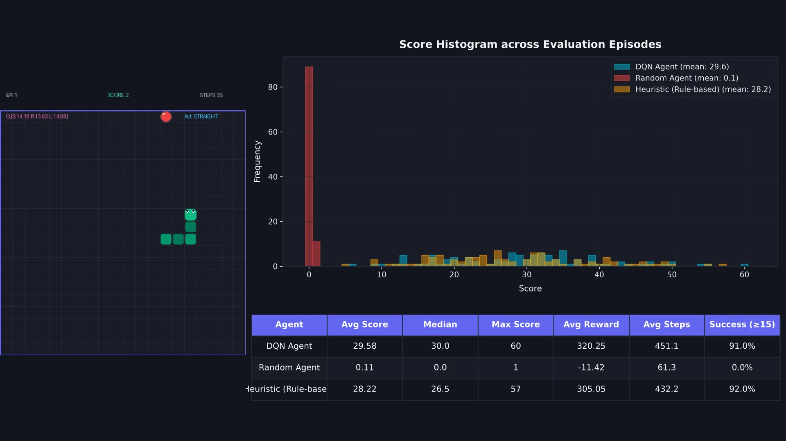
This composite visual pairs a rendered `SnakeRenderer` board frame displaying live action Q-values (`Q[S:14.18 R:13.63 L:14.09]`, `Act STRAIGHT`) with the 100-episode evaluation score histogram and summary table confirming DQN's right-shifted score distribution up to `60` apples.

### 7. Training Reward Progression per Episode
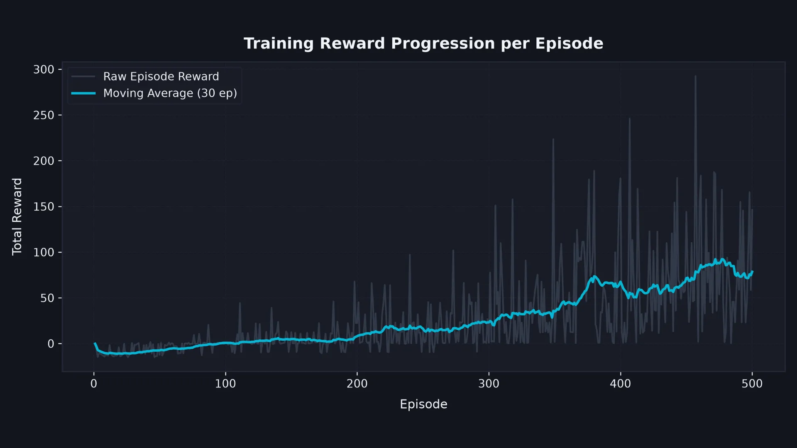
Raw episode returns and the 30-episode moving average across 500 training episodes show steady learning progression from negative early collision penalties (`-15.02` minimum) to sustained positive returns peaking at `292.65` (with a peak rolling reward of `92.362`).

### 8. Snake Game Score Learning Curve
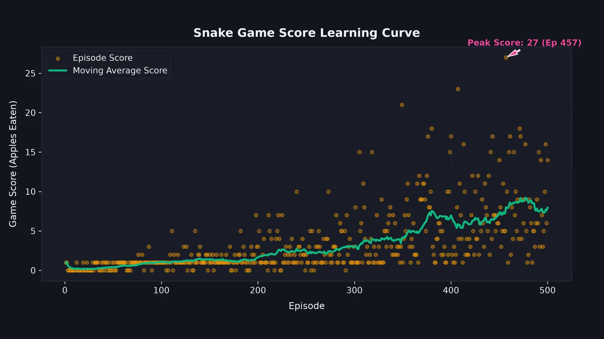
Episode apple counts and the 30-episode moving average track the transition from initial random exploration (`0–2` apples in episodes `1–150`) to strategic navigation peaking at `27` apples in Episode `457` and a peak rolling average of `9.20` in Episode `477`.

### 9. Survival Episode Length (Steps)
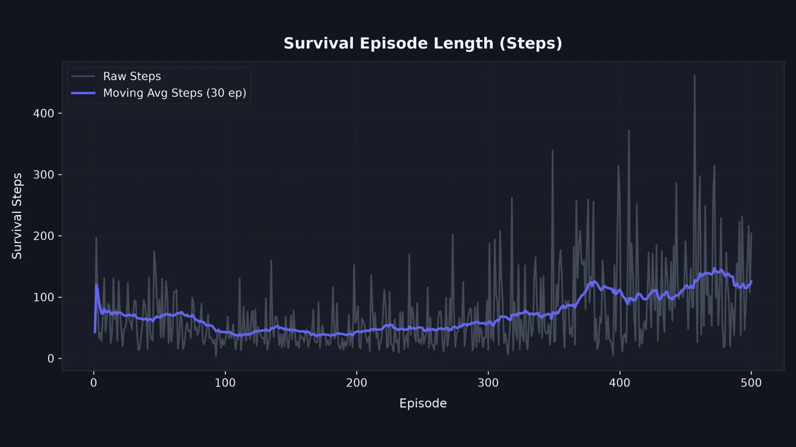
Survival step counts rise alongside policy maturity from under `50` steps during early exploration to a 30-episode moving average exceeding `140` steps near Episode `475`, reaching a maximum single-episode survival length of `461` steps at Episode `457`.

### 10. Temporal-Difference (Huber) Training Loss
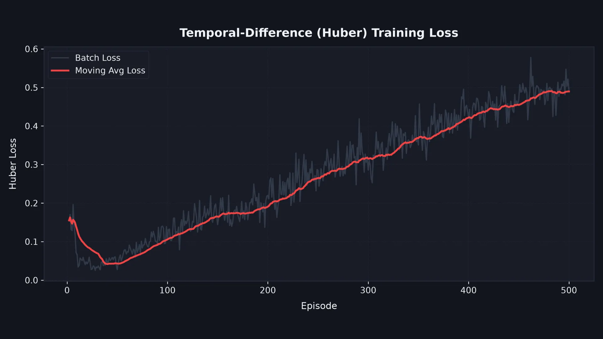
Batch Huber loss and its moving average rise smoothly from `~0.04` in early short episodes to `~0.49` toward Episode `500`, reflecting expanding TD-target magnitudes as episodes lengthen and cumulative discounted rewards grow larger.

### 11. Epsilon-Greedy Decay & Evaluation Score Boxplot
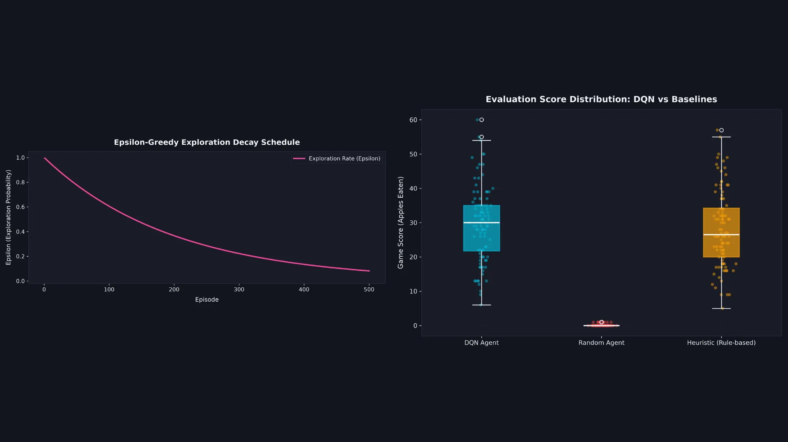
Combining the exponential $\epsilon$-greedy decay curve (`1.0` to `0.0816` over 500 episodes) with the 100-episode evaluation boxplot highlights DQN's higher median (`30.0`) and peak (`60`) score distribution relative to both `Random Agent` (`0.0` median) and `Heuristic (Rule-based)` (`26.5` median).

## Prerequisites

- **Python**: Version 3.9+ (compatible with `torch>=2.0.0`, `numpy>=1.24.0`, `pandas>=2.0.0`, `streamlit>=1.30.0`)
- **Hardware**: Standard multi-core CPU is sufficient for both training (~71s for 500 episodes) and inference; CUDA GPU is optional and automatically used if available via `torch.cuda.is_available()`
- **Package Manager**: `pip` (with `venv` or `conda` recommended)

## Installation & Setup

1. Clone the repository and navigate into the project directory:

```bash
git clone https://github.com/weztcy/Strategic-Game-Playing-Agent-Using-Deep-Q-Learning-DQN.git
cd "Strategic Game Playing Agent Using Deep Q-Learning (DQN)"
```

2. Create and activate a Python virtual environment:

```bash
python -m venv .venv
# Windows (PowerShell)
.\.venv\Scripts\Activate.ps1
# Linux / macOS
source .venv/bin/activate
```

3. Install required dependencies from `requirements.txt`:

```bash
pip install -r requirements.txt
```

## Usage & Execution

You can inspect the pre-trained model (`models/best_model.pt`), launch the interactive Streamlit dashboard, run comparative evaluations, or execute the test suite directly from the repository root.

1. Run the interactive dark-theme Streamlit dashboard (`streamlit/app.py`):

```bash
python -m streamlit run streamlit/app.py --server.port 8501 --theme.base dark
```

2. Evaluate the trained checkpoint (`models/best_model.pt`) against Random and Heuristic baselines:

```bash
python -m src.evaluation.evaluate --model models/best_model.pt --episodes 100
```

3. Generate publication-style Matplotlib charts and animated gameplay GIFs:

```bash
python -c "from src.visualization.plots import generate_all_plots; generate_all_plots()"
```

4. Run the automated `pytest` verification suite:

```bash
python -m pytest -v tests
```

## Reproducibility & Execution

Training and evaluation determinism is controlled via explicit seed initialization (`np.random.default_rng`, `random.Random`, and `torch.manual_seed`) and centralized hyperparameters in `config/config.yaml`. Note that `src/training/train.py` and `src/evaluation/evaluate.py` default to writing outputs under `results/metrics/` and `results/evaluation/` unless overridden, while the pre-generated repository artifacts reside in `metrics/`, `evaluation/`, `figures/`, and `models/`.

1. Re-run the exact 500-episode Double DQN training protocol with seed `42`:

```bash
python -m src.training.train --episodes 500 --seed 42 --config config/config.yaml
```

2. Re-run the 100-episode multi-seed evaluation protocol (`seeds: [42, 101, 202, 303, 404]`):

```bash
python -m src.evaluation.evaluate --model models/best_model.pt --config config/config.yaml --episodes 100 --outdir evaluation
```

3. Keep in mind that minor floating-point nondeterminism can still arise across different CPU/GPU hardware architectures or PyTorch versions when reproducing training trajectories from scratch.

## Contributing

Contributions to improve environment features, network architectures (such as enabling `DuelingQNetwork` or grid-vision CNN encoders), or evaluation benchmarks are welcome.

1. Fork the repository.
2. Create a branch for the change.
3. Make the changes.
4. Run relevant checks or tests (`python -m pytest -v tests`) when available.
5. Commit and push the branch.
6. Open a pull request with a clear explanation.

## License

This project is licensed under the MIT License.
See the [LICENSE](LICENSE) file for details.

## Author & Contact

**Yohanes Dimas Pratama**

- GitHub: [github.com/weztcy](https://github.com/weztcy)
- Portfolio: [yohanesdimas.com](https://yohanesdimas.com)
- LinkedIn: [linkedin.com/in/yohanes-dimas](https://www.linkedin.com/in/yohanes-dimas)
